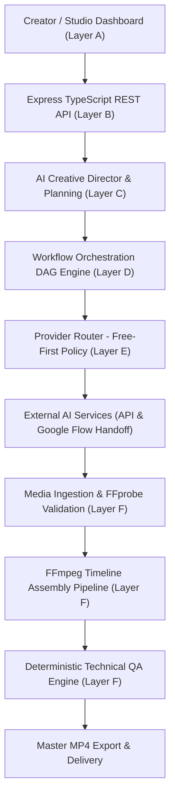

# CreatorFlow AI — LLM-Powered Universal Video Production Orchestration Platform

[-emerald)](https://github.com/arjunghuge644)
[](https://nodejs.org/)
[](LICENSE)
[](https://github.com/arjunghuge644)

**CreatorFlow AI** is an intelligent, LLM-powered universal video production orchestration platform.

> **CRITICAL ARCHITECTURAL PRINCIPLE**: CreatorFlow AI is an **orchestration platform, NOT a generative media model**. We do not build custom generative video models, image models, TTS models, or custom 3D animation engines. Instead, CreatorFlow AI orchestrates existing external AI services, coordinates their asynchronous Directed Acyclic Graph (DAG) task execution, validates outputs with FFprobe, and assembles broadcast-ready media using FFmpeg.

---

## 🌟 Key Capabilities

1. **Universal AI Creative Director**:
   - Takes arbitrary user ideas and plans structured productions across any video category (documentaries, educational explainers, product promos, storytelling, tutorials, social shorts).
   - Generates scripts, storyboard scenes, camera directions, lighting, and provider-optimized prompts.

2. **Persistent Workflow Engine (DAG)**:
   - Dependency-aware Directed Acyclic Graph of production tasks backed by MongoDB.
   - 12 deterministic states: `pending`, `ready`, `queued`, `running`, `awaiting_external_action`, `awaiting_approval`, `completed`, `failed`, `retry_scheduled`, `blocked`, `cancelled`, `skipped`.
   - Independent tasks execute concurrently (video generation runs in parallel with audio narration).
   - Idempotency keys and server crash recovery.

3. **Two Provider Integration Modes**:
   - **API Mode**: Programmatic job submission, polling, and asset retrieval for authorized APIs (Gemini, ElevenLabs, etc.).
   - **Manual Handoff Mode**: For external creative tools without public APIs (e.g. Google Flow, Runway, Midjourney). Generates production-ready prompts, provides direct links and instructions, awaits user upload, validates media via FFprobe, and advances the pipeline.

4. **Hands-Off Automated Post-Production Pipeline**:
   - Ingesting the final required scene clip **automatically triggers the downstream post-production pipeline**.
   - The user is not required to manually merge clips, synchronize narration, burn subtitles, process audio, or run routine QA.

5. **Intelligent Timeline Synchronization**:
   - `TimelineSynchronizer` aligns variable video durations with spoken narration cadence.
   - Bounded corrections: trimming, limited speed adjustments (`0.85x – 1.15x`), frame holds, and silence padding.

6. **Automatic Subtitles & FFmpeg Media Assembly**:
   - Automatic `.srt` subtitle generation with millisecond precision supporting English and Hindi Unicode (Devanagari).
   - Burns subtitles with safe-area margins.
   - Loudness normalization (`loudnorm=I=-16:TP=-1.5:LRA=11`).
   - Normalizes all clips into clean H.264/AAC MP4 master files across formats (`9:16` vertical, `16:9` horizontal, `1:1` square).

7. **Deterministic Technical Quality Verification (QA Engine)**:
   - Technical checks: container integrity, H.264 stream validation, resolution conformance, silence detection (`mean_volume > -65dB`), timeline duration conformance (±2.5s tolerance).
   - QA Outcomes: `PASSED`, `PASSED_WITH_WARNINGS`, `REQUIRES_REVIEW`, `FAILED`.

8. **Failure-Aware Partial Scene Regeneration**:
   - Invalidate and regenerate a single affected scene without wasting quota on approved assets or re-recording narration.

---

## 🏗️ 6-Layer Architecture



---

## 🚀 Quick Start

### Prerequisites
- **Node.js** v20+ (v26 recommended)
- **FFmpeg & FFprobe** 7.0+ (with `libx264`, `libass`, `aac`, `loudnorm`)
- **MongoDB** 7.0+ (or local isolated memory server for tests)
- **Redis** 7.0+ (optional for background workers)

### Installation

```bash
# Clone the repository
git clone https://github.com/arjunghuge644/youtube-Automation.git
cd youtube-Automation

# Install dependencies
npm install

# Build shared contracts
npm run build -w @creatorflow/shared
```

### Environment Configuration

Copy the example environment configuration:

```bash
cp .env.example .env
```

Key environment variables:
```ini
NODE_ENV=development
PORT=3000
MONGODB_URI=mongodb://localhost:27017/creatorflow
REDIS_URL=redis://localhost:6379
JWT_SECRET=your-secure-jwt-secret-key-at-least-32-chars
SESSION_SECRET=your-session-secret-key-at-least-32-chars
# Optional External API Keys (Defaults to Free-First local providers):
# GEMINI_API_KEY=your_gemini_api_key
# ELEVENLABS_API_KEY=your_elevenlabs_api_key
```

### Running the Services

```bash
# Run backend API server
npm run dev -w @creatorflow/api

# Run frontend React/Vite development studio
npm run dev -w @creatorflow/web
```

---

## 🧪 Testing & Verification

CreatorFlow AI includes an automated test suite verifying everything from schema validation to real FFmpeg video assembly against an isolated database:

```bash
# Run all unit, integration, and end-to-end tests
npm test

# Run typecheck across all monorepo packages
npm run typecheck

# Build production bundles
npm run build
```

### Test Suite Summary:
```text
Test Files  8 passed (8)
     Tests  55 passed (55)
  Duration  30.02s
```

---

## 📂 Project Structure

```
youtube-Automation/
├── apps/
│   ├── api/                     # Node.js Express & TypeScript REST API
│   │   ├── src/
│   │   │   ├── media/           # FFmpeg assembly, FFprobe validator, QA engine, subtitles
│   │   │   ├── orchestration/   # DAG engine, compiler, task manager, recovery
│   │   │   ├── planner/         # Creative Director, script generator, storyboard
│   │   │   ├── providers/       # Google Flow manual handoff, TTS, provider router
│   │   │   ├── app.ts           # REST endpoints & middleware
│   │   │   └── models.ts        # Mongoose schemas (tasks, storyboards, assets)
│   │   └── test/                # API and automated post-production integration tests
│   └── web/                     # React + Vite + Tailwind studio dashboard
│       └── src/
│           ├── StoryboardWorkspace.tsx # Google Flow handoff & prompt copy UI
│           ├── WorkflowDashboard.tsx   # Live DAG task matrix & QA inspector
│           └── pages/ProjectPage.tsx   # Project workspace & scene planning
├── packages/
│   └── shared-types/            # Shared Zod schemas, TypeScript types, and contracts
├── docs/                        # Architectural documentation & specifications
├── package.json                 # Monorepo configuration
└── README.md
```

---

## 📖 Architectural Documentation

- [System Architecture](docs/ARCHITECTURE.md)
- [Workflow Engine & DAG Model](docs/WORKFLOW_ENGINE.md)
- [Provider Contracts & Routing](docs/PROVIDER_CONTRACTS.md)
- [Implementation Roadmap](docs/IMPLEMENTATION_PLAN.md)
- [Progress Log](docs/PROGRESS.md)
- [Testing Guidelines](docs/TESTING.md)

---

## 👤 Author

**Arjun Ghuge**
- GitHub: [@arjunghuge644](https://github.com/arjunghuge644)

---

## 📄 License

This project is licensed under the MIT License - see the LICENSE file for details.
