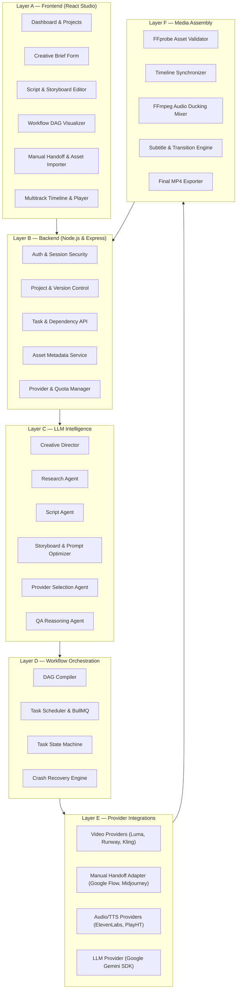

# CreatorFlow AI — Platform Architecture

## 1. System Mission

CreatorFlow AI is an **LLM-powered universal video production orchestration platform**.
The platform coordinates external generative AI providers, user creative workflows, asset ingestion, deterministic media quality assurance, and FFmpeg media assembly.

**Explicit Boundary**: CreatorFlow AI does not develop custom generative video models, custom image diffusion models, neural TTS models, or proprietary 3D animation engines.

---

## 2. Six-Layer Architecture



---

### Layer A — Frontend Studio
- **User Dashboard**: Workspace overview, project listings, version tracking, and progress indicators.
- **Creative Brief**: Category selection (`educational`, `documentary`, `product_promo`, `storytelling`, `social_short`, `tutorial`, `motivational`, `custom`), aspect ratios (`9:16`, `16:9`, `1:1`), duration, audio preferences.
- **Workflow DAG Visualizer**: Shows active production graph, concurrent tasks, dependencies, and state highlights.
- **Manual Handoff Modal**: Displays production-ready prompt, negative prompt, camera directives, provider link, and drag-and-drop asset importer with immediate FFprobe feedback.
- **Storyboard & Scene Workspace**: Per-scene visual descriptions, narration scripts, provider assignment overrides, and selective regeneration controls.

### Layer B — Backend & Security
- **Authentication**: Salted scrypt hashing, HTTP-only session cookies, rotation on login, CSRF tokens.
- **Optimistic Concurrency**: Version tracking (`expectedVersion`) on projects, scripts, storyboards, and timeline configurations.
- **Data Isolation**: Strict per-user tenancy enforcement.
- **Audit Logging**: Structured production events recording all status transitions, provider calls, and human approvals.

### Layer C — LLM Production Intelligence
- **Creative Director**: Receives user intent and outputs validated production specifications.
- **Script Agent**: Writes structured narrative hooks, dialogue, voiceovers, and scene breakdowns.
- **Storyboard Planner**: Deconstructs scenes into shots with camera angles, motion paths, lighting, and provider-specific prompt parameters.
- **Prompt Optimizer**: Adapts generic scene descriptions into provider-specific prompts (e.g. tuning keywords for Luma vs Runway vs Google Flow).
- **Provider Router**: Evaluates capabilities, availability, quotas, and cost to assign optimal providers.

### Layer D — Workflow Orchestration Engine
- **Persistent DAG**: Directed acyclic graph representing every production stage from prompt to MP4 export.
- **Task Lifecycle**:
  `pending` → `ready` → `queued` → `running` → [`awaiting_external_action` | `awaiting_approval`] → `completed` / `failed` / `retry_scheduled` / `cancelled` / `skipped`
- **Concurrency**: Independent tasks execute in parallel across BullMQ queues.
- **Idempotency**: Prevents duplicate provider submissions using deterministic hash keys.
- **Restart Recovery**: Restores in-flight state and re-evaluates dependency readiness after server restarts.

### Layer E — External Provider Integrations
- **API Mode**: Programmatic dispatch, job status polling, and automatic asset retrieval for supported APIs.
- **Manual Handoff Mode**: Handles providers without public APIs (e.g. Google Flow). Provides production-ready prompts and handles manual file ingestion.
- **Free-First Policy**: Zero budget by default. No automatic paid API calls or silent fallbacks.

### Layer F — Media Assembly
- **Asset Validation**: Deterministic FFprobe inspection for container, codec (H.264), resolution, aspect ratio, audio presence, and duration drift.
- **Multitrack Synchronization**: Aligns video tracks, narration, background music, sound effects, subtitles, and text overlays.
- **FFmpeg Assembly**: Hardware-accelerated or software concatenation, transition filters (`xfade`), audio volume ducking during speech, and subtitle burn-in.

---

## 3. Database Schema Architecture

```
users                 -> Accounts, credentials, roles
projects              -> Video brief, category, aspect ratio, duration, status, version
scripts               -> Hook, scenes, narration, approval state, version
storyboard_scenes     -> Shot details, visual prompts, camera config, negative prompts
tasks                 -> Granular DAG nodes, state, attempts, idempotency key, result
task_dependencies     -> Edges in task DAG (prerequisiteTaskId -> dependentTaskId)
assets                -> Ingested/generated media metadata, file path, checksum, FFprobe metrics
external_jobs         -> Correlation with third-party provider job IDs
timeline_versions     -> Multitrack timeline snapshots and clip definitions
production_events     -> Timestamped audit log of state changes
provider_usage        -> Quota tracking, token counts, generation minutes, cost accounting
```
