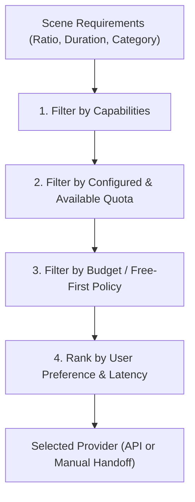

# CreatorFlow AI — Provider Contracts & Integration Specifications

## 1. Provider Architecture Overview

CreatorFlow AI abstracts external AI services through strongly typed interfaces. The system coordinates providers without relying on custom media generation models or proprietary engines.

---

## 2. Common Provider Interfaces

### Video Generation Provider Interface

```typescript
export interface ProviderCapabilities {
  textToVideo: boolean;
  imageToVideo: boolean;
  referenceImages: boolean;
  supportedDurations: number[]; // e.g. [4, 5, 10]
  supportedAspectRatios: ('9:16' | '16:9' | '1:1')[];
  nativeAudioSupported: boolean;
  maxConcurrency: number;
  costPerSecondUsd: number;
  isFreeTierEligible: boolean;
}

export interface VideoGenerationRequest {
  taskId: string;
  projectId: string;
  sceneId: string;
  prompt: string;
  negativePrompt?: string;
  durationSeconds: number;
  aspectRatio: '9:16' | '16:9' | '1:1';
  referenceImageUrls?: string[];
  seed?: number;
  cameraMotion?: string;
}

export interface ProviderSubmission {
  externalJobId: string;
  status: 'QUEUED' | 'PROCESSING' | 'COMPLETED' | 'FAILED';
  estimatedDurationSeconds?: number;
}

export interface ProviderJobStatus {
  externalJobId: string;
  status: 'QUEUED' | 'PROCESSING' | 'COMPLETED' | 'FAILED';
  progressPercentage: number;
  error?: string;
  assetUrls?: string[];
}

export interface VideoProvider {
  readonly id: string;
  readonly name: string;
  getCapabilities(): Promise<ProviderCapabilities>;
  submit(request: VideoGenerationRequest): Promise<ProviderSubmission>;
  getStatus(externalJobId: string): Promise<ProviderJobStatus>;
  cancel?(externalJobId: string): Promise<void>;
  fetchResult(externalJobId: string): Promise<{ url: string; mimeType: string; duration: number }[]>;
}
```

### Audio / TTS Provider Interface

```typescript
export interface AudioGenerationRequest {
  taskId: string;
  projectId: string;
  sceneId: string;
  text: string;
  language: 'hi' | 'en' | 'hinglish';
  voiceId?: string;
  style?: 'documentary' | 'calm' | 'energetic';
}

export interface AudioProvider {
  readonly id: string;
  readonly name: string;
  synthesizeSpeech(request: AudioGenerationRequest): Promise<{
    externalJobId: string;
    audioUrl?: string;
    durationSeconds?: number;
  }>;
}
```

---

## 3. Dual Integration Modes

### Mode 1: API Mode
Used when a provider provides a documented, authorized REST or gRPC API.
- **Workflow**:
  1. Orchestrator calls `provider.submit(request)`.
  2. Orchestrator stores `externalJobId` on the task record.
  3. Worker polls `provider.getStatus(id)` or receives verified webhooks.
  4. On completion, orchestrator downloads asset to local/S3 storage.
  5. Asset is sent to FFprobe validation.

### Mode 2: Manual Handoff Mode (e.g. Google Flow, Runway, Midjourney)
Used when a service does not expose a public API or the user prefers manual control.
- **Workflow**:
  1. The orchestrator compiles a production-ready scene prompt, negative prompt, aspect ratio, duration, and camera directives.
  2. The task transitions to `awaiting_external_action`.
  3. The UI presents the user with:
     - Direct link to provider (e.g. Google Flow portal)
     - One-click copyable prompt and parameter settings
     - Drag-and-drop asset uploader
  4. The user completes generation in the external tool and uploads the resulting MP4.
  5. The backend validates the imported file with FFprobe (checking codec, resolution, duration, integrity).
  6. On successful validation, the task marks `completed` and automatically triggers dependent downstream DAG tasks.

> **Strict Rule**: CreatorFlow AI never uses unofficial browser scraping, reverse-engineered private APIs, or credential interception.

---

## 4. Intelligent Provider Router

The provider router deterministically selects providers before making any LLM call:



### Free-First Policy
1. Default budget is set to **\$0.00**.
2. If no free-tier API provider is available, the router assigns **Manual Handoff Mode** with zero automatic charges.
3. Paid providers require explicit user configuration and budget approval in workspace settings.

