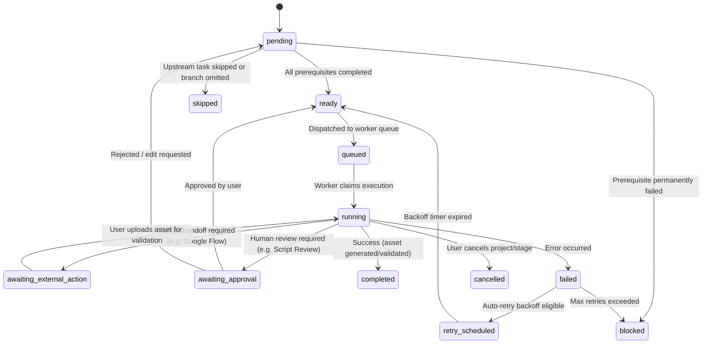
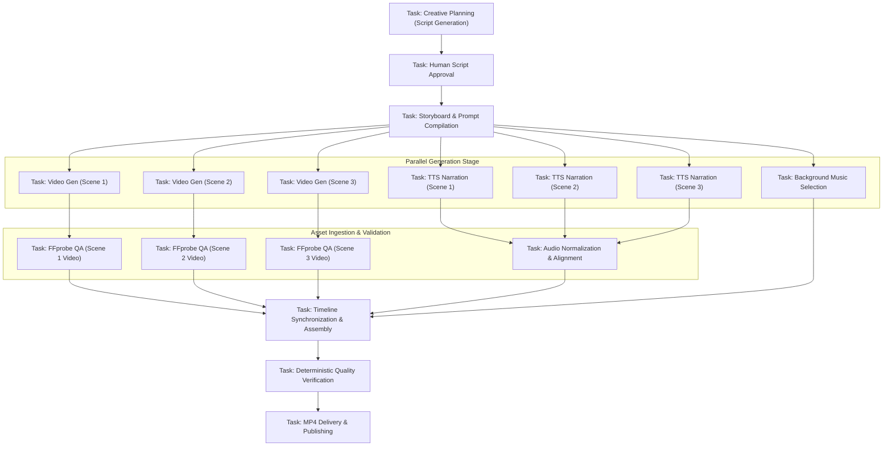

# CreatorFlow AI — Workflow Engine & DAG Specification

## 1. Overview

The Workflow Engine is the core orchestration backbone of CreatorFlow AI. It models every video project as an executable, persistent Directed Acyclic Graph (DAG) of discrete tasks.

The engine coordinates asynchronous distributed execution, enforces prerequisites, enables maximum parallel concurrency, handles human-in-the-loop checkpoints, manages manual provider handoffs, and ensures crash resilience.

---

## 2. Task State Machine

### State Definitions

| State | Meaning |
| --- | --- |
| `pending` | Task is waiting for one or more prerequisite tasks to complete successfully. |
| `ready` | All upstream dependencies are met; task is eligible for scheduling. |
| `queued` | Task has been pushed to the BullMQ processing queue. |
| `running` | Worker is actively executing the task. |
| `awaiting_external_action` | Generation must occur in an external UI (e.g. Google Flow). Waiting for user asset upload. |
| `awaiting_approval` | Requires explicit user sign-off (e.g. script approval, final video review). |
| `completed` | Task finished successfully and output metadata/assets are persisted. |
| `failed` | Execution threw an unhandled error or validation rejected the output. |
| `retry_scheduled` | Transient failure detected; waiting for exponential backoff before transitioning to `ready`. |
| `blocked` | An upstream dependency failed permanently or required provider quota is exhausted. |
| `cancelled` | Task was intentionally aborted by the user or an enclosing pipeline cancellation. |
| `skipped` | Task was bypassed because an optional feature or conditional branch was omitted. |

---

## 3. Standard Production DAG Topology

---

## 4. Key Orchestration Guarantees

### 1. Concurrency & Non-Blocking Execution
- Independent tasks run in parallel. A video generation task for Scene 1 never blocks an audio generation task for Scene 2.
- A task transitions to `ready` as soon as all prerequisite tasks report `completed`.

### 2. Idempotency Keys
- Each task computes a deterministic idempotency key based on:
  `hash(projectId + taskId + inputPayloadHash + attemptCount)`
- Prevents double-submission to external paid or quota-limited APIs.

### 3. Worker Restart & Crash Recovery
- On backend startup, the engine queries for tasks stuck in `running` or `queued`.
- In-flight tasks with external job IDs are polled to check if the third-party job finished while the server was restarting.
- Tasks without external job references are safely reset to `ready` to re-enter the queue.

### 4. Selective Partial Regeneration
- If a user rejects Scene 2's video:
  1. Only Scene 2's video task and downstream tasks (Scene 2 QA, Assembly, Final QA) are invalidated.
  2. Scene 1 and Scene 3 video assets, plus all approved narration tracks, remain completely preserved.
  3. No unnecessary external provider calls are made.

